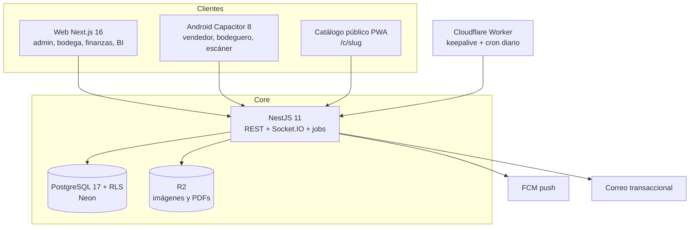

# PartOps — Arquitectura v1 y plan de construcción

**Objetivo:** SaaS multi-tenant de repuestos automotrices para Guatemala: catálogo con compatibilidad vehicular, inventario multi-bodega confiable, venta/despacho en tiempo real, catálogo público y BI de demanda incumplida. Todo en planes gratuitos, con identidad propia y sin un solo dato de demo.

**Base real estudiada:** `C:\nexoops` — `packages/db/prisma/schema.prisma`, `apps/api/src/modules/imports/imports.service.ts`, `apps/api/src/modules/inventory/inventory.service.ts`, `apps/api/src/infra/jobs.service.ts`, `apps/api/src/infra/realtime.gateway.ts`, `apps/api/src/modules/store/store.controller.ts`, `packages/ui/src/styles/tokens.css`, `ARCHITECTURE.md`. Se reutilizan los patrones probados; no se copia la marca ni la paleta.

**Stack:** pnpm 11 + Turborepo · NestJS 11 · Prisma 7 + PostgreSQL 17 (Neon) · Next.js 16 (Cloudflare Workers) · Capacitor 8 (Android) · Socket.IO · cola durable en Postgres (sin Redis).

---

## 1. Veredicto: qué se queda y qué se rompe

Se queda: la separación API/web/móvil/catálogo, el `tenant_id` como eje, el flujo vendedor→bodeguero→despacho, la importación Excel con validación previa, el BI de búsquedas sin resultado y el enrutamiento de pedidos entre bodegas.

Se rompe (cada punto es un bug de producción, no un detalle de estilo):
1. **`warehouse_stock.quantity` sin ledger.** No hay forma de auditar, conciliar ni deshacer. Toda mutación va a un `stock_movement` inmutable + `inventory_level(onHand, reserved)` con upsert atómico en SQL. Prueba obligatoria: dos ventas simultáneas de la última pieza → una gana, la otra recibe `OUT_OF_STOCK`.
2. **`DECIMAL` para dinero.** Deriva de redondeo en totales e IVA. Todo en centavos enteros (`Int`); formateo solo en la capa de presentación.
3. **`tenant_id` sin RLS.** Un `where` olvidado filtra datos entre negocios. `ENABLE` + `FORCE ROW LEVEL SECURITY` con `app.tenant_id` por transacción y rol de runtime sin `BYPASSRLS` (patrón de `20261022060000_rls_and_search`). Test de aislamiento en CI, no opcional.
4. **`vehicles` plano.** Sin marca/modelo normalizados no hay facetas Marca→Modelo→Año y se duplica "Toyota Corolla 2009" en cada fila. Se normaliza: `vehicle_brand` → `vehicle_model` → `vehicle` (aplicación: años, motor, carrocería). Referencia global, curada, sin `tenant_id`.
5. **Compatibilidad sin código OEM.** En repuestos la mayoría de búsquedas empiezan por número de parte. `partNumber` por variante + `oemNumbers[]` con índice GIN + tabla de sinónimos (`capó/cubierta`, `faro/foco/óptica`, `defensa/bumper`).
6. **Estado de pedido único + `warehouse_id` en la cabecera.** No soporta surtido parcial ni traslado. Estado **por línea**, reserva con expiración, `stock_transfer` para surtir desde central, `order_event` append-only.
7. **Costo no congelado en la venta.** La utilidad se calcula contra el costo actual → mentira. `unitCostCents` snapshot en la línea.
8. **`search_demand_logs.raw_query`.** "capo corolla" y "CAPÓ COROLLA 2009" cuentan doble. Query normalizada + `vehicleId`/`categoryId` resueltos + agregado diario con retención.
9. **Sin cola ni idempotencia.** PDF, push y avisos se pierden si el proceso muere. `background_job` durable en Postgres + claves de idempotencia.
10. **"Notificar por WhatsApp" automático no es gratis** (Cloud API exige verificación de Meta). Se entrega con `wa.me` prellenado + bandeja de avisos; automatización después.
11. **Falta pasillo/estante**, que el propio flujo del bodeguero promete. `binLocation` en `inventory_level`.
12. **UUID v4.** Se usa `uuid(7)` para localidad de índice y mejor inserción.

---

## 2. Mapa del sistema

**Repositorio (monorepo, mismo formato que NexoOps):**
- `apps/api` — NestJS: REST `/api`, auth `/api/auth`, realtime `/realtime`.
- `apps/web` — Next.js App Router: landing, auth, `/app`, `/c/[slug]`, `/r/[token]`, `/admin`.
- `apps/mobile` — Capacitor que carga `/app` (siempre actualizado) y expone cámara/escáner/push/share.
- `packages/contracts` — Zod: permisos, dinero, vehículos, búsqueda, pedidos, importador.
- `packages/db` — Prisma + migraciones RLS + referencia vehicular + provisionamiento.
- `packages/ui` — tokens, logo, primitivas, gráficas.
- `packages/emails` — React Email (invitación, verificación, resumen diario).
- `infra/` — init de Postgres, keepalive Worker, docker-compose opcional.
- `scripts/` — check-secrets, smoke, render-brand, restore-drill.

---

## 3. Infra gratuita (cuenta partopsgt@gmail.com)

- **DB:** Neon Free — 0.5 GB, ~190 h de cómputo/mes, suspensión por inactividad, historial 6 h. Un proyecto, ramas para preview.
- **API:** Render Free — 512 MB / 0.1 CPU, duerme a los 15 min, 750 h/mes. Keepalive desde Cloudflare Worker cada 10 min (`infra/keepalive`).
- **Web:** Cloudflare Workers Free — 100k req/día, sin egress. **No Vercel:** el plan Hobby prohíbe uso comercial.
- **Archivos:** Cloudflare R2 Free — 10 GB, 1M escrituras, 10M lecturas, egress 0. Bucket privado; salida por `/api/files/:key` con caché hasta comprar dominio y pasar a `cdn.`.
- **Correo:** Resend Free — 3,000/mes, 100/día, **exige dominio verificado**. Mientras no exista dominio: Gmail SMTP con app password de partopsgt@gmail.com (~500/día) detrás de una interfaz `MailProvider`, y se cambia a Resend con una variable.
- **Push:** FCM, gratis.
- **Errores/uptime:** Sentry Developer (5k errores/mes) + Better Stack free (10 monitores).
- **CI:** GitHub Actions 2,000 min/mes. **Antibots:** Turnstile free.
- **Android:** APK firmado y distribuido por GitHub Releases (gratis). Play Console cuesta US$25 único; iOS requiere Apple Developer US$99/año → fuera del alcance free, se documenta.
- **Dominio:** pendiente (el usuario lo compra después). Todo lo que dependa de dominio queda detrás de una variable: `PUBLIC_WEB_URL`, `EMAIL_FROM`, `R2_PUBLIC_URL`.

**Lo que el free tier sí condiciona (y cómo se resuelve):**
- Neon suspende y Render duerme → keepalive + arranque en frío asumido: primera petición del día puede tardar; el shell web muestra esqueleto, nunca error.
- 0.5 GB → retención de `search_event` 30 días (agregados permanentes), imágenes re-codificadas a AVIF/WebP ≤1400px, PDFs comprimidos.
- Workers free con 10 ms de CPU por invocación → páginas estáticas/cacheadas primero, `caches.default` en el catálogo público, islas de cliente para lo interactivo. Si el límite aprieta, plan B: mover web a Render (mismo repo, un job más de CI).

---

## 4. Identidad PartOps (propia, no plantilla)

**Concepto: "la tuerca abierta".** Hexágono de cabeza de perno con una muesca en el vértice inferior derecho; el negativo interior dibuja una P. La muesca es cobre: la pieza que sale de bodega. Se lee a 16 px porque es una silueta sólida con un solo corte.
- **Marca:** `packages/ui/src/brand/logo-mark.tsx` (SVG, `viewBox 0 0 48 48`, hexágono de 6 vértices, corte de 9° al vértice inferior derecho, P en negativo con contraforma redondeada, muesca `#B4703A`, cuerpo `#16324F`), `logo-wordmark.tsx` (PARTOPS en Archivo 800, tracking -0.02em, una sola tinta), `logo-mono.tsx`, `logo-vertical.tsx`. Assets: `public/brand/` con icon-512/192/180/maskable-512 (safe area 20%), favicon.svg, splash 2732, og-image 1200x630, generados por `scripts/render-brand.mjs` (sharp) desde el SVG fuente.
- **Paleta (OKLCH, AA verificado):** azul taller `#16324F` (base), azul profundo `#0E2233` (dark), cobre `#B4703A` (acento gráfico ≤8% del área; para texto sobre claro usar `#8F5626`), tiza `#F7F5F1`, grafito `#1D2327`, acero `#8A949B`, verde existencia `#2E6B4F`, ámbar bajo mínimo `#C98A12`, rojo agotado `#A8322A`.
- **Diferenciación obligatoria:** CHAMS ya usa cobre. En PartOps el cobre **solo** aparece como filete de 2 px, muesca del logo y serie de gráfica; nunca como superficie ni fondo. Fondos fríos azules, cero arena.
- **Tipografía:** Archivo (display 700/800), Public Sans (texto), JetBrains Mono (SKU, OEM, folios, cantidades). `next/font` auto-hospedado.
- **Motivos propios:** `CodeChip` (código mono con barra cobre), `StockPill` (punto + número, no semáforo de color plano), `ShelfLabel` (etiqueta imprimible 50x30 mm con QR y OEM), trama de muesca a 45° al 6% en cabeceras de sección y estados vacíos, `VehicleBreadcrumb` (Marca›Modelo›Año).
- **Geometría:** radios 4/8 px, hairlines 1 px `#E3DED4`, una sola elevación, sin blur, sin glow, sin degradados de marca, sin botones píldora. Densidad de tabla 36 px de alto, `tabular-nums` en toda cifra.
- **Prohibido:** violeta/magenta, vidrio, hero de tres tarjetas, cifras o usuarios inventados, UI en inglés.

---

## 5. Modelo de datos (v1)

**Global (sin tenant, curado por plataforma):** `vehicle_brand`, `vehicle_model`, `vehicle` (años desde/hasta, motor, carrocería), `part_term` (sinónimos y términos GT), `part_category` semilla.

**Por negocio (`tenantId` en todo, RLS):** `tenant` (marca, NIT, teléfono, moneda, IVA bps, prefijo de folio), `member`/`role`/`invitation` + `audit_log`, `warehouse` (`code`, `isDefault`, `sellsOnline`), `customer`, `part` (`categoryId`, `brand`, `condition`, `unit`, `warrantyDays`, `isUniversal`, `searchText` tsvector generado), `part_variant` (`sku`, `partNumber`, `oemNumbers[]`, `barcode`, `priceCents`, `costCents`, `title`, `position`), `part_image`, `part_compatibility` (`partId`, `vehicleId`, único), `part_option`/`part_option_value`/`variant_option_value` (lado, posición, acabado), `inventory_level` (`onHand`, `reserved`, `reorderPoint`, `binLocation`, único `variantId+warehouseId`), `stock_movement` (delta, balanceAfter, tipo, ref), `stock_transfer`+items, `sales_order` (`number` por tenant, `channel`, `status`, `customerContact`), `sales_order_item` (`unitPriceCents`, `unitCostCents` snapshot, `status`, `fulfillFromWarehouseId`), `order_event`, `payment`, `receipt` (folio, token 128 bits, pdfKey, snapshot JSON), `expense`+`expense_category`, `daily_metrics`, `search_event` (query cruda + normalizada + vehículo/categoría + resultCount + source), `demand_daily`, `stock_watch`, `import_job`/`import_row_error`, `notification`, `background_job`, `push_token`, `audit_log`.

**Invariantes en la base, no en el código:** `onHand >= 0`, `reserved >= 0 y <= onHand`, `stock_movement` sin UPDATE/DELETE (trigger), `yearEnd >= yearStart`, `unitPriceCents >= 0`, únicos `(tenantId, sku)`, `(tenantId, barcode)`, `(tenantId, partId, vehicleId)`, `(tenantId, number)` en pedidos y recibos, `CHECK` de rol y estado por enum.

**Numeración:** contador por tenant con `SELECT ... FOR UPDATE` sobre `tenant.settings`; sin huecos en el caso normal, y el recibo es inmutable (snapshot + PDF en R2).

**Dinero:** `Int` centavos, GTQ, IVA 12% incluido en precio por defecto (`taxRateBps=1200`, `pricesIncludeTax=true`), desglose calculado con `allocateProportionally` para que las líneas siempre sumen el total.

---

## 6. Rendimiento y confiabilidad (lo que se mide)

**Presupuestos (p95, datos de 5,000 piezas / 12,000 aplicaciones / 30,000 movimientos, medidos en CI con fixture sintético — solo test):**
- Búsqueda por texto/OEM/año: < 80 ms.
- Lista de catálogo con facetas: < 150 ms.
- Crear pedido (reserva incluida): < 250 ms.
- Preparación de bodega (leer orden + ítems): < 120 ms.
- Dashboard "Hoy": < 400 ms (desde `daily_metrics`, no `SUM` sobre pedidos).
- Importación 1,000 filas: < 60 s con progreso en vivo.
- Catálogo público (cacheado): TTFB < 200 ms.

**Cómo se logra:** índices GIN trigram sobre `part.name`, `part_variant.partNumber`, `oeoNumbers`, `barcode`; tsvector español con `unaccent`; paginación por cursor; una sola transacción por request con `tenant` fijado (el pool no se agota); caché en memoria 30 s de settings/entitlements invalidada por evento; `COUNT` solo donde importa; imágenes AVIF; sin `SELECT *` en listas.

**Cómo se garantiza:** ledger inmutable + reservas atómicas; idempotency key en pedido/importación/recibo; `background_job` con reintentos y lock de 15 min; outbox para push/WhatsApp; `/health/live` y `/health/ready` (pool, migración aplicada, versión del commit); logs estructurados con request id; alerta de consulta > 200 ms; respaldo nocturno `pg_dump` a R2 con retención 14 días y simulacro de restauración documentado.

---

## 7. Tareas

Convención: cada tarea cierra con `pnpm lint && pnpm typecheck && pnpm test` verde y commit propio. Base de datos de desarrollo = rama de Neon (`DATABASE_URL` runtime, `DIRECT_DATABASE_URL` migraciones).

### Fase 0 — Cimientos

**T1. Monorepo, entorno y CI**
- Archivos: `package.json`, `pnpm-workspace.yaml`, `turbo.json`, `biome.json`, `tsconfig.base.json`, `packages/config/*`, `.env.example`, `infra/docker-compose.yml` (opcional), `.github/workflows/ci.yml`, `scripts/check-secrets.mjs`.
- Pasos: workspace con `apps/*` y `packages/*`; scripts `dev|build|typecheck|test|lint|db:*`; CI con gitleaks, lint, tipos, tests, build de API y web; `env.ts` validado con Zod que falla al arrancar si falta un secreto.
- Verificación: `pnpm install && pnpm lint && pnpm typecheck && pnpm test` exit 0; CI verde en el primer push.

**T2. Identidad y design system**
- Archivos: `packages/ui/src/styles/tokens.css`, `packages/ui/src/brand/*.tsx`, `packages/ui/src/components/{button,input,select,table,sheet,badge,code-chip,stock-pill,empty-state,stat-tile,chart}.tsx`, `packages/ui/src/lib/{cn,format}.ts`, `scripts/render-brand.mjs`, `apps/web/public/brand/*`.
- Pasos: tokens OKLCH de la sección 4 con variantes claro/oscuro; logo en sus cuatro formas; assets rasterizados; primitivas con foco visible cobre, estados hover/active/disabled/loading, tablas densas con encabezado fijo; `MoneyInput` que trabaja en centavos; una ruta interna `/brand` (protegida, no pública) que muestra la hoja de marca.
- Test: unitario de `formatMoney/toCents` (incluye "Q 1,250.50" y "1250,5"); visual Playwright de `/brand` claro y oscuro; contraste AA verificado en test.
- Verificación: `node scripts/render-brand.mjs` produce 8 PNG; `pnpm --filter @partops/web test:e2e -- brand`.

**T3. Esquema v1, RLS, referencia vehicular**
- Archivos: `packages/db/prisma/schema.prisma`, `packages/db/prisma/migrations/0001_init`, `0002_rls_and_search`, `packages/db/src/{client,tenant,provision,vehicle-seed}.ts`, `packages/db/data/vehicles/*.json`, `packages/db/test/rls.test.ts`.
- Pasos: modelos de la sección 5 con `uuid(7)` y centavos; migración RLS con `FORCE` sobre toda tabla con `tenantId` + rol `partops_app` sin `BYPASSRLS`; GIN trigram, tsvector con `unaccent`, checks e índices únicos; semilla real de marcas/modelos/aplicaciones del mercado GT (Toyota, Nissan, Honda, Mazda, Mitsubishi, Hyundai, Kia, Chevrolet, Suzuki, Isuzu, Ford, VW, BMW, Mercedes, Jeep, Dodge, JAC, Chery, Changan, Great Wall, Foton) y diccionario de sinónimos; **cero** tenants/productos/pedidos de ejemplo.
- Test: `rls.test.ts` — con `app.tenant_id = A` una lectura devuelve 0 filas de B; `INSERT` con tenant B falla; `system` sí ve todo; checks de stock y de rangos de año rechazan datos inválidos.
- Verificación: `pnpm --filter @partops/db migrate:deploy && pnpm --filter @partops/db test`; `psql` confirma `relrowsecurity` y `relforcerowsecurity` en todas las tablas de negocio.

**T4. Auth, tenants, RBAC y onboarding**
- Archivos: `apps/api/src/auth/*`, `apps/api/src/common/{context,guards,db.service,zod.pipe}.ts`, `apps/api/src/modules/{tenants,team,account}/*`, `packages/contracts/src/{permissions,roles}.ts`, `apps/web/src/app/(auth)/*`, `apps/web/src/app/onboarding/*`, `packages/emails/src/*`.
- Pasos: Better Auth (email+password, sesión en cookie httpOnly, verificación, recuperación, 2FA opcional); `Ctx` con `tenantId`, permisos y `warehouseIds`; guards `@Public/@NoTenant/@RequirePermissions/@PlatformAdmin`; roles base PROPIETARIO/ADMIN/GERENTE/BODEGUERO/VENDEDOR definidos por permisos (`inventory.*`, `orders.*`, `warehouses.*`, `finance.*`, `catalog.*`, `team.*`, `settings.*`); onboarding de 4 pasos (negocio y NIT, logo y color, primera bodega, invitar equipo) sin datos precargados; escopado de bodega aplicado en el servidor.
- Test: registro→onboarding→login; invitación caduca y de un solo uso; vendedor recibe 403 en `/finance`; bodeguero solo ve sus bodegas; aislamiento de tenant en endpoints con `tenantId` en el path.
- Verificación: `pnpm --filter @partops/api test` con suite e2e de Playwright en `apps/web/e2e/auth.spec.ts`.

### Fase 1 — Catálogo e inventario (el corazón)

**T5. Búsqueda y compatibilidad**
- Archivos: `packages/contracts/src/{search,vehicles}.ts`, `apps/api/src/modules/catalog/search.service.ts`, `apps/api/src/modules/catalog/vehicles.controller.ts`, migración `0003_search_rank`.
- Pasos: parser determinista de consulta (`"capo toyota corolla 2009"` → término + marca + modelo + año, tolerante a sin acentos y errores con trigram); SQL de ranking único (coincidencia exacta OEM > partNumber > nombre > trigram) con facetas Marca/Modelo/Año/Categoría/Bodega; cascada Marca→Modelo→Año; respuesta con stock por bodega y `binLocation`; registro de `search_event` (incluye cero resultados) sin bloquear la respuesta.
- Test: OEM exacto encuentra la pieza; "capo corola 09" tolera error; año fuera de rango no aparece; faceta sin resultados devuelve vacío coherente; el evento se registra una sola vez por búsqueda.
- Verificación: test de integración + `EXPLAIN ANALYZE` del query de búsqueda por debajo de 80 ms con el fixture de 5,000 piezas.

**T6. Catálogo: piezas, variantes, imágenes, matriz de compatibilidad**
- Archivos: `apps/api/src/modules/catalog/{parts.controller,parts.service,images.service}.ts`, `apps/web/src/app/app/catalogo/**`, `apps/web/src/components/catalog/**`.
- Pasos: CRUD con variantes por opciones (Lado/Posición/Acabado), SKU y OEM únicos por tenant, condición (nuevo/usado/remanufacturado), unidad, garantía; matriz de compatibilidad por rango de años con alta masiva desde el selector de vehículo; imágenes con re-encode (sharp → AVIF/WebP ≤1400 px, sin EXIF) a R2 y orden arrastrable; tabla virtualizada con filtros guardados, edición inline de precio/stock y acciones masivas; ficha con stock por bodega, pasillo/estante y últimos movimientos.
- Test: SKU duplicado rechazado; OEM duplicado rechazado; compatibilidad duplicada idempotente; imagen > 8 MB rechazada; borrar pieza con movimientos la archiva, no la elimina.
- Verificación: `pnpm --filter @partops/api test catalog`; Playwright crea pieza, agrega compatibilidad y ve stock.

**T7. Inventario: niveles, ledger, reservas, traslados, mínimos**
- Archivos: `apps/api/src/modules/inventory/{inventory.service,inventory.controller,low-stock.job}.ts`, `apps/api/src/modules/warehouses/*`, migración `0004_inventory_guards`.
- Pasos: `apply()` con upsert SQL atómico (delta y reserva), rechazo `OUT_OF_STOCK` con código estable, movimiento inmutable con `balanceAfter`; `reserve/release` con expiración de 30 min y job de limpieza; traslado con estados SOLICITADO→ENVIADO→RECIBIDO y doble asiento; punto de reorden por bodega y alerta diaria; ajuste con motivo obligatorio y auditoría.
- Test: dos ventas simultáneas de la última unidad (una gana); reserva expirada libera stock; traslado descuadra si falta un asiento (debe fallar la transacción); `onHand` nunca negativo; ajuste sin motivo rechazado.
- Verificación: test de concurrencia con 20 transacciones paralelas contra la misma fila; `pnpm --filter @partops/api test inventory`.

**T8. Importación Excel/CSV**
- Archivos: `packages/contracts/src/importer.ts`, `apps/api/src/modules/imports/*`, `apps/web/src/app/app/catalogo/importar/**`.
- Pasos: mapeo de columnas (SKU, OEM, nombre, categoría, marca/modelo/año desde-hasta, motor, lado/posición, costo, precio, bodega, stock, ubicación, unidad, condición, garantía, imagen) con vista previa; validación previa por fila (años inválidos, vehículo inexistente → queda como solicitud pendiente, nunca compatibilidad basura); estrategia TODO_O_NADA vs omitir inválidas; job en background con progreso por WebSocket y reporte de errores descargable en xlsx; caché de SKU por lote para que 3,000 filas no hagan 30,000 consultas.
- Test: fixture de 500 filas con duplicados, años invertidos y vehículo desconocido; reimportación es idempotente; límite de plan se valida antes de arrancar; reporte de errores contiene la fila original.
- Verificación: importación de 1,000 filas < 60 s con progreso visible; `pnpm --filter @partops/api test imports`.

### Fase 2 — Vender y despachar

**T9. Pedidos y surtido**
- Archivos: `packages/contracts/src/orders.ts`, `apps/api/src/modules/orders/{orders.controller,orders.service,order-engine.service}.ts`, `apps/web/src/app/app/pedidos/**`.
- Pasos: crear pedido con `Idempotency-Key`; numeración por tenant; resolución de surtido por línea (bodega del vendedor → otra bodega con stock → traslado desde central); reserva al confirmar; estados por línea (PENDIENTE, EN_PREPARACION, LISTO, ENTREGADO, SIN_STOCK, CANCELADO) y estado derivado en cabecera; cancelación libera reservas; eventos append-only; pago (efectivo, tarjeta, transferencia, mixto) con vuelto calculado en centavos.
- Test: pedido de 3 líneas surtidas de 2 bodegas; cancelación parcial; reintento con la misma clave no duplica; total con IVA incluido cuadra al centavo; no se puede entregar sin pago o sin autorización.
- Verificación: `pnpm --filter @partops/api test orders`; Playwright crea pedido y ve la orden en la cola de bodega.

**T10. Despacho del bodeguero: realtime, escáner, offline**
- Archivos: `apps/api/src/infra/realtime.gateway.ts`, `apps/api/src/infra/push.service.ts`, `apps/web/src/app/app/despacho/**`, `apps/web/src/lib/{realtime,outbox}.ts`, `apps/mobile/**`.
- Pasos: gateway autenticado por sesión + tenant, sala por tenant y por usuario, reconexión con backoff y re-sincronización al volver; push FCM como garantía cuando el socket está caído; pantalla de preparación con objetivos táctiles ≥ 44 px, verificación por escaneo de SKU (bloquea avanzar con código equivocado), "no está" → parcial + traslado; cola offline en IndexedDB (Dexie) para cambios de estado con reintento idempotente; indicador acústico y vibración opcional.
- Test: escanear código ajeno no marca la línea; doble escaneo no duplica; evento perdido se recupera al reconectar; cambio de estado encolado offline se aplica una sola vez al reconectar.
- Verificación: Playwright con dos contextos (vendedor y bodeguero) sobre el mismo pedido; prueba en dispositivo Android real del build de T16.

**T11. Recibo PDF y WhatsApp**
- Archivos: `apps/api/src/modules/receipts/*`, `packages/ui/src/pdf/*`, `apps/web/src/app/r/[token]/**`, `packages/contracts/src/whatsapp.ts`.
- Pasos: PDF carta y ticket 80 mm con `pdf-lib` (logo del tenant, colores, OEM, compatibilidad del vehículo, NIT, desglose de IVA, QR al recibo público), generado una vez y guardado inmutable en R2 con token de 128 bits; endpoint público por token con `noindex` y sin exponer datos de otros pedidos; mensaje de WhatsApp prellenado con folio, total y enlace; reenvío desde el pedido.
- Test: totales e IVA cuadran con el pedido al centavo; token inválido 404; regenerar no cambia el PDF publicado; el PDF no incluye costo interno ni datos de otro tenant.
- Verificación: `pnpm --filter @partops/api test receipts`; inspección manual del PDF en carta y 80 mm.

### Fase 3 — Catálogo público y demanda

**T12. Catálogo público PWA**
- Archivos: `apps/api/src/modules/public-catalog/*`, `apps/web/src/app/c/[slug]/**`, `apps/web/src/app/manifest.ts`, `apps/web/public/sw.js`.
- Pasos: resolución por slug sin filtrar tenants inexistentes; selector de vehículo (Marca→Modelo→Año) + búsqueda; tarjetas con OEM, condición, precio y "N disponibles en [bodega]"; pedido por WhatsApp con mensaje estructurado que crea pedido `channel=CATALOGO` cuando hay sesión de cliente o queda como solicitud; Turnstile + rate limit por IP; guest checkout sin cuenta; imágenes optimizadas y caché de borde.
- Test: slug de otro tenant no revela stock; producto sin stock no permite pedir; rate limit corta el abuso; pedido creado desde catálogo entra a la misma cola de bodega.
- Verificación: Lighthouse móvil ≥ 90 en rendimiento; `pnpm --filter @partops/api test public`.

**T13. Demanda incumplida y avisos de stock**
- Archivos: `apps/api/src/modules/demand/*`, `apps/web/src/app/app/demanda/**`, migración `0005_demand_rollup`.
- Pasos: `search_event` con query normalizada y vehículo resuelto; rollup diario a `demand_daily`; panel con top consultas sin resultado, por vehículo, por categoría, evolución mensual y tasa de conversión búsqueda→pedido; bandeja "avisar cuando llegue" (`stock_watch`) que al entrar stock genera la lista de WhatsApp con un clic; job de retención a 30 días.
- Test: dos variantes de la misma consulta agrupan; consulta con resultados no cuenta como demanda; rollup cuadra con los eventos; retención no borra agregados.
- Verificación: `pnpm --filter @partops/api test demand`; panel muestra números reales de la BD de desarrollo.

### Fase 4 — Dinero, plataforma y entrega

**T14. Finanzas y métricas diarias**
- Archivos: `apps/api/src/modules/finance/*`, `packages/contracts/src/finance.ts`, `apps/web/src/app/app/finanzas/**`.
- Pasos: ingresos por día/vendedor/bodega/forma de pago; egresos con categoría (alquiler, planilla, fletes, servicios, importaciones) y gastos recurrentes; COGS desde el costo congelado de la línea; `Utilidad = ventas − COGS − gastos`; `daily_metrics` recalculado por job; exportación xlsx/csv con los mismos números que la pantalla.
- Test: utilidad cuadra al centavo con fixture; cambio de costo no altera meses cerrados; zona horaria America/Guatemala no corre el corte de día; egreso de mes anterior no entra al mes actual.
- Verificación: `pnpm --filter @partops/api test finance`; comparación pantalla vs export (mismos totales).

**T15. Dashboard, paleta de comandos, auditoría y panel de plataforma**
- Archivos: `apps/web/src/app/app/(dashboard)/**`, `apps/web/src/components/app/{command-palette,sidebar,topbar}.tsx`, `apps/api/src/modules/{platform,account}/*`, `apps/web/src/app/admin/**`.
- Pasos: dashboard "Hoy" (ventas, pedidos por despachar, agotados, búsquedas sin respuesta) con acciones reales; ⌘K que busca piezas, OEM, pedidos y clientes y permite escanear con el cursor en cualquier pantalla; bitácora de auditoría de mutaciones sensibles; `/admin` con tenants, referencia vehicular, salud de jobs, demanda global y concesión manual de planes (sin pasarela de pago en v1).
- Test: permiso ausente oculta y bloquea; auditoría registra quién/qué/cuándo; ⌘K no muestra datos de otro tenant; `/admin` inaccesible para no-plataforma.
- Verificación: Playwright de los tres flujos; revisión de consultas lentas en logs.

**T16. Android con Capacitor**
- Archivos: `apps/mobile/{capacitor.config.ts,package.json,www/offline.html}`, `apps/mobile/android/**`, `.github/workflows/android.yml`.
- Pasos: shell que carga `/app` (siempre actualizado) con `offline.html` de respaldo; plugins de cámara/ML Kit, push, share, haptics, keep-awake; iconos y splash desde los assets de T2; escáner integrado en despacho y búsqueda; build de APK firmado por tag en CI y publicación en GitHub Releases.
- Test: instalación limpia sin red muestra offline y reintenta; escaneo abre la cámara y devuelve SKU; push llega con la app cerrada (dispositivo real).
- Verificación: APK instalado en Android físico completa venta + despacho de punta a punta.

**T17. Producción: despliegue, observabilidad, respaldos, hardening**
- Archivos: `.github/workflows/{ci,deploy,backup}.yml`, `render.yaml`, `apps/api/Dockerfile`, `apps/web/wrangler.jsonc`, `infra/keepalive/*`, `scripts/{smoke-api,restore-drill}.mjs`, `SECURITY.md`, `RUNBOOK.md`.
- Pasos: pipeline en serie migrar→API→verificar commit en `/health/ready`→web→smoke; keepalive y cron diario en Worker; Sentry con trazas al 10%; headers y CSP con nonce; rate limits por ruta; `gitleaks` y `check-secrets`; respaldo nocturno a R2 con retención 14 días y simulacro de restauración; runbook de caídas (Neon suspendido, Render dormido, R2 sin dominio).
- Test: smoke contra producción (dominio, salud, CSP, login); restauración desde un dump en base limpia y verificación de conteos; intento de fuga entre tenants en producción con dos cuentas reales.
- Verificación: despliegue completo desde un commit vacío; `pnpm smoke` verde; restauración documentada con evidencia.

---

## 8. Puertas de aceptación

- **Fin de Fase 0:** CI verde, `/brand` exporta assets, test de RLS en verde, onboarding crea un negocio real sin datos de ejemplo.
- **Fin de Fase 1:** búsqueda p95 < 80 ms con 5,000 piezas, lista < 150 ms, importación de 1,000 filas < 60 s, cero rutas sin RLS.
- **Fin de Fase 2:** venta concurrente de la última pieza nunca sobrevende, despacho completo desde Android con escáner, recibo correcto al centavo.
- **Fin de Fase 3:** catálogo público sin fuga de stock, Lighthouse móvil ≥ 90, panel de demanda con datos reales.
- **Fin de Fase 4:** utilidad cuadra con export, APK distribuible, respaldo restaurado con evidencia, dos tenants reales aislados en producción.

## 9. Riesgos y decisiones diferidas

- **Workers free (10 ms CPU)** puede apretar en SSR pesado; mitigación: caché de borde y páginas estáticas; plan B documentado a Render.
- **Render duerme** aunque haya keepalive si el Worker falla; mitigación: reintento del Worker, esqueleto en el cliente y alerta de uptime.
- **Correo sin dominio** limitado a Gmail SMTP; se cambia a Resend al comprar dominio (una variable y verificación DNS).
- **WhatsApp automático** requiere Cloud API y verificación de Meta; v1 usa `wa.me` + bandeja de avisos. No se promete automatización que no existe.
- **iOS** fuera de alcance free (US$99/año); la PWA cubre iPhone mientras tanto.
- **Diferido con razón:** cotizaciones con expiración, notas de crédito, compras a proveedor con costo promedio, factura FEL, multi-sucursal con transferencias automáticas por IA, buscador con LLM. Cada uno tiene su lugar en el modelo; ninguno se simula.
